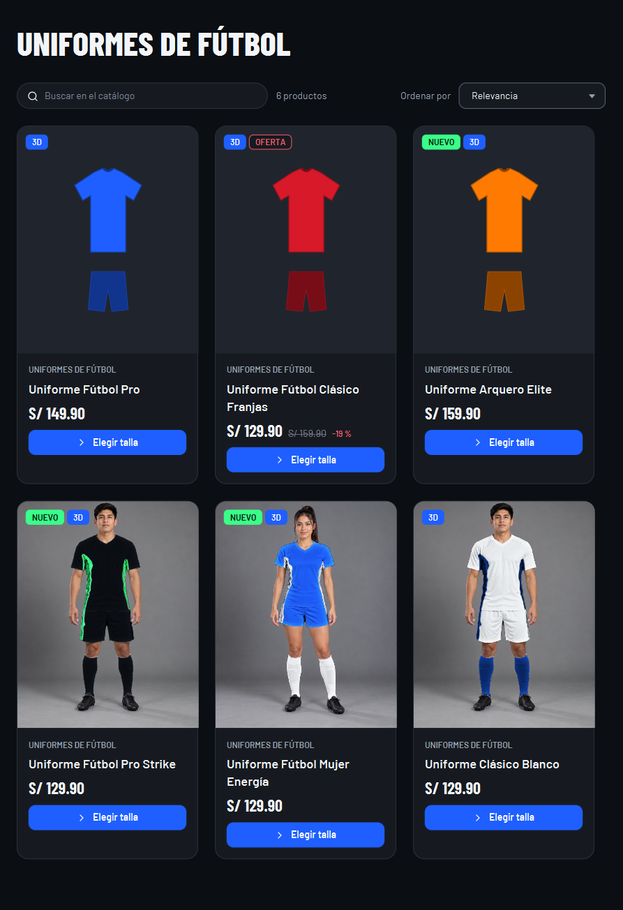
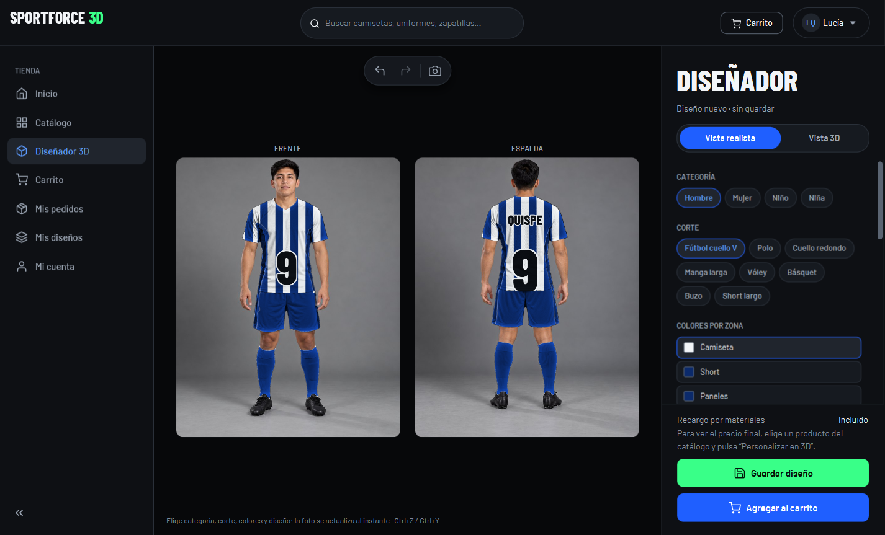
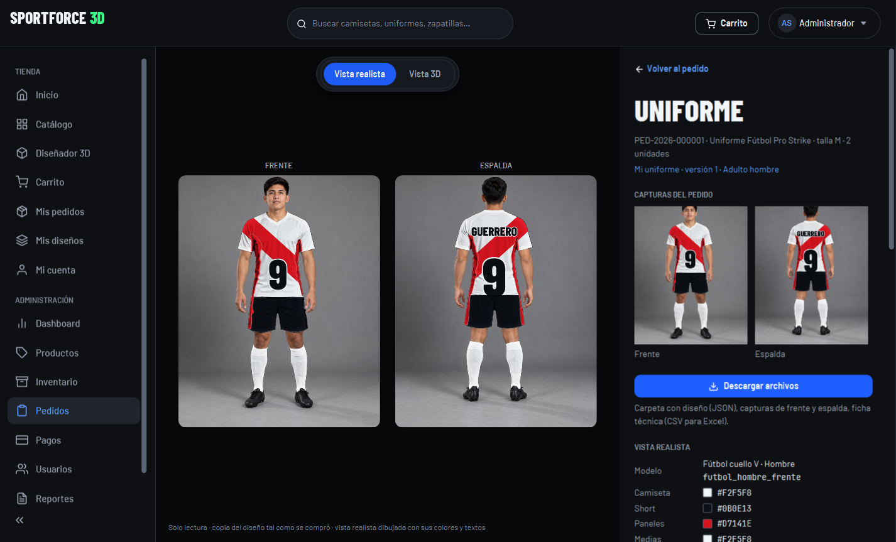

# SPORTFORCE 3D

Aplicación de escritorio para vender ropa deportiva (camisetas, uniformes, shorts, medias, zapatillas, buzos y accesorios) con un **diseñador** donde el cliente personaliza su uniforme sobre **fotos de personas reales recoloreadas en vivo** o sobre un maniquí 3D.

Es **una sola aplicación JavaFX** que guarda todo en un archivo **SQLite** en la computadora. No hace falta instalar ningún servidor ni base de datos aparte, y con el instalador de Windows **tampoco hace falta tener Java**.

**Versión 1.0.0 + Etapa 7** — catálogo, carrito y pedidos; diseñador con **vista realista** (fotos recoloreadas) y **vista 3D**; pagos con Yape, Plin y transferencia verificados por un administrador; panel de administración con dashboard, **reportes PDF/Excel**, **configuración de los datos de pago** y visor del uniforme comprado (foto realista y 3D); pruebas automáticas (también de interfaz) e instalador de Windows.

| Catálogo realista | Diseñador (vista realista) | Uniforme del pedido (ADMIN) |
| --- | --- | --- |
|  |  |  |

Pantallas de la Etapa 7: [docs/capturas/etapa7](docs/capturas/etapa7) · todas las pantallas (1.0): [docs/capturas/final](docs/capturas/final) · reporte de ejemplo: [PDF](docs/capturas/final/reporte-ventas-ejemplo.pdf) y [Excel](docs/capturas/final/reporte-ventas-ejemplo.xlsx).

## Contenido

1. [Instalar la aplicación (Windows)](#1-instalar-la-aplicación-windows)
2. [Primeros pasos después de instalar](#2-primeros-pasos-después-de-instalar)
3. [Uso como CLIENTE](#3-uso-como-cliente)
4. [Uso como ADMIN](#4-uso-como-admin)
5. [La base de datos: dónde está y cómo reiniciarla](#5-la-base-de-datos-dónde-está-y-cómo-reiniciarla)
6. [Desarrollo: abrir, ejecutar y probar el proyecto](#6-desarrollo-abrir-ejecutar-y-probar-el-proyecto)
7. [Generar el instalador](#7-generar-el-instalador)
8. [Seguridad](#8-seguridad)
9. [Problemas frecuentes](#9-problemas-frecuentes)
10. [Vista realista: fotos, máscaras y modelos nuevos](#10-vista-realista-fotos-máscaras-y-modelos-nuevos)
11. [Vista 3D: cambiar o agregar una persona desde MakeHuman](#11-vista-3d-cambiar-o-agregar-una-persona-desde-makehuman)
12. [Vista 3D: tela simulada en Blender](#12-vista-3d-tela-simulada-en-blender)
13. [Estructura del proyecto](#13-estructura-del-proyecto)
14. [Integrantes y módulos](#14-integrantes-y-módulos)

---

## 1. Instalar la aplicación (Windows)

1. Ejecuta **`SPORTFORCE 3D-1.0.0.exe`** (se genera como se explica en la [sección 7](#7-generar-el-instalador)).
2. Si Windows muestra *"Windows protegió su PC"*, pulsa **Más información → Ejecutar de todas formas** (el instalador no está firmado digitalmente).
3. Elige la carpeta (por defecto `C:\Program Files\SPORTFORCE 3D`) y si quieres un acceso directo en el escritorio.
4. Abre **SPORTFORCE 3D** desde el menú Inicio o el escritorio.

No necesitas Java: el instalador trae su propio Java 21 reducido (unos 100 MB instalado). Requisitos: Windows 10 u 11 de 64 bits y una tarjeta gráfica con DirectX 9 o superior para el visor 3D.

**Dónde guarda los datos la versión instalada:** `%APPDATA%\SportForce3D\data\` (por ejemplo `C:\Users\Ana\AppData\Roaming\SportForce3D\data\`). Ahí están la base de datos `sportforce3d.db`, los archivos subidos (`storage\`), los borradores del diseñador (`drafts\`) y los registros (`logs\sportforce3d.log`).

**Actualizar:** instala la nueva versión encima; reemplaza el programa y **conserva los datos** (las migraciones nuevas se aplican solas al abrir).

**Desinstalar:** *Configuración → Aplicaciones → SPORTFORCE 3D → Desinstalar*. La carpeta `%APPDATA%\SportForce3D` **no se borra** (para no perder pedidos); bórrala a mano si quieres eliminar todo.

## 2. Primeros pasos después de instalar

La base de datos nueva trae **datos de prueba**: 68 productos (44 de ellos con foto realista recoloreada) y dos usuarios con contraseñas conocidas.

| Rol | Correo | Contraseña |
| --- | --- | --- |
| ADMIN | `admin@sportforce3d.pe` | `Admin123!` |
| CLIENTE | `cliente@sportforce3d.pe` | `Cliente123!` |

Antes de atender clientes reales:

1. Entra como **ADMIN** y cambia la contraseña en **Mi cuenta → Cambiar contraseña**.
2. Abre **Administración → Configuración** y escribe los **datos de pago reales** (número y titular de Yape y de Plin, banco, titular, número de cuenta y CCI). Mientras sigan los de prueba, el Dashboard y Configuración muestran un aviso.
3. En **Administración → Usuarios**, desactiva la cuenta de prueba `cliente@sportforce3d.pe` (o cámbiale la contraseña entrando con ella).
4. Revisa productos, precios y stock en **Productos** e **Inventario**.

> **Precios de ejemplo.** Los 44 productos del catálogo realista (`V6`, de `sportforce-realista/catalogo.json`, SKU `SF-001` a `SF-044`, más *Zapatillas Fútbol FG Strike* y *Canilleras Pro*, que ya existían y se actualizaron) vienen marcados como **precio de ejemplo**: se cargaron tal cual, pero el ADMIN debe revisarlos y corregirlos en **Productos** antes de vender. Su stock inicial (5 a 40 unidades por talla) también es de ejemplo.
>
> **Productos con foto provisional (Etapa 12A).** `V8` dio foto realista a los productos antiguos. Siete usan la foto más parecida mientras no tengan una propia: SF-UFU-003 (arquero, foto de manga larga), SF-CAM-003 (running reflectiva, cuello redondo), SF-ENT-002 (compresión manga larga, manga larga suelta), SF-SHO-003 (short 2 en 1, short de fútbol), SF-MED-002 (media caña, media alta), SF-BUZ-002 (casaca, buzo con pantalón) y SF-ZAP-002 (futsal, zapatilla con tacos). Siguen con dibujo, sin foto parecida: SF-ACC-002 (brazalete), SF-ACC-003 (guantes), SF-ACC-004 (mochila) y SF-ZAP-003 (zapatillas de running). SF-BUZ-001 duplicaba a SF-037 y quedó oculto (borrado lógico).
>
> **Tela "Poliéster liso" sin precio definido.** La sección **Tela** del diseñador ofrece Dry-fit (incluido), Poliéster liso, Algodón (incluido) y Malla deportiva (+S/ 5.00 por prenda, el recargo que ya tenía la malla). Poliéster liso no existía en el catálogo: `V7` lo agrega **sin recargo** (S/ 0.00). Si debe costar más, define su recargo en la tabla `materials` (columna `surcharge_cents`, código `POLIESTER_LISO`) con una migración nueva.

## 3. Uso como CLIENTE

- **Crear cuenta:** en la pantalla de inicio pulsa **Regístrate** (nombre, correo, celular opcional y contraseña de 8 caracteres o más con letras y números). Las cuentas nuevas siempre son CLIENTE.
- **Catálogo:** filtra por categoría, deporte, talla, precio, *solo con stock* o *personalizables en 3D*, ordena y busca (sin importar tildes: "futbol" encuentra "Fútbol").
- **Ficha del producto:** elige color, talla y cantidad; ves el stock disponible. **Agregar al carrito**. Los productos de talla única se agregan desde la tarjeta.
- **Diseñador** (menú lateral, o **Personalizar en 3D** en un producto personalizable). Tiene dos pestañas:
  - **Vista realista** (la principal): fotos de personas reales con el uniforme recoloreado al instante, **frente y espalda lado a lado** (los buzos solo tienen frente). Elige **categoría** (Hombre, Mujer, Niño, Niña), **corte** (Fútbol cuello V, Polo, Cuello redondo, Raglán, Manga larga, Vóley, Básquet, Buzo, Short largo, Licra; solo los que existen para esa categoría), **colores por zona** (camiseta, short, paneles, medias), **diseño** (liso, rayas, franjas horizontales, dinámico, geométrico, minimal en hombros, banda diagonal) con su color, **nombre** (12 letras, en la espalda) y **número** (0–99). Si entras desde un producto, empieza con sus colores y su diseño. **Es el mismo diseño que la Vista 3D**: lo que cambias en una se ve en la otra al instante (persona, colores, diseño, nombre, números, escudo, manga larga y short largo). Si algo del diseño no tiene foto (short corto, medias tobilleras o de media pierna, tela, cuello o banda de otro color, textos movidos), se muestra la foto más parecida, con los colores y textos del diseño, y un aviso pequeño debajo (por ejemplo *Medias tobilleras: ver en Vista 3D*). Las capturas que se guardan con el diseño (y que el pedido copia) son estas fotos cuando la foto muestra todo el diseño; si hay algún aviso, se toman de la Vista 3D.
  - **Vista 3D**: una **persona en 3D** (Hombre, Mujer, Niño o Niña, la misma categoría que la vista realista: si cambias una, cambia la otra). La persona lleva **el uniforme puesto** y todo lo que cambias (colores por zona, patrones, telas, nombre, número, emblemas y logos) se ve en vivo sobre ella; los nombres, números y logos se arrastran sobre la prenda. Al cambiar de persona tarda unos segundos la primera vez (se ajusta el uniforme a su cuerpo). Si falta el modelo de la persona se muestra el maniquí de siempre. Pestañas Diseño, Texto, Logos y Capas:
  - **Arrastrar:** girar 360° · **rueda:** acercar · **clic derecho + arrastrar:** subir o bajar · **doble clic** o **Reiniciar:** restablecer. Botones **Frente**, **Espalda** y **Costado** (cada clic cambia de lado). Teclado: flechas, `+`/`−`, `1`–`4` (frente, espalda, lados), `0`.
  - **Diseño:** prenda, persona (o maniquí de respaldo: hombre, mujer, juvenil), colores por zona, patrones y **Tela** de camiseta y short (Dry-fit, Poliéster liso, Algodón o Malla deportiva: cada una cambia el relieve y el brillo en la Vista 3D; la malla deja ver sus agujeros al acercarse; el recargo se suma en vivo y la de serie va incluida).
  - **Texto:** una tarjeta por opción (nombre y número en la espalda, número en el pecho y en el short); al pulsarla se agrega y su caja para escribir, tipografía, color, contorno, tamaño y giro aparecen debajo, con la papelera para quitarla.
  - La cámara solo se mueve cuando la mueves tú (arrastrar, rueda, Frente/Espalda/Costado/Reiniciar): editar no la gira ni la acerca.
  - **Texto:** nombre (12 letras) y número (0–99) en espalda, pecho y short, con tipografía, color, contorno, tamaño y giro.
  - **Logos:** emblemas de la biblioteca o tu logo PNG/SVG (máx. 5 MB, declarando que tienes derecho a usarlo; no se aceptan marcas de terceros). Arrástralos sobre el maniquí.
  - **Capas**, **Ctrl+Z / Ctrl+Y**, **Supr**, **Ctrl+S**. Guardar crea una versión nueva; cada 30 s se guarda un borrador. Deshacer, guardar y el borrador valen para las dos vistas.
  - **Agregar al carrito:** guarda el diseño si hace falta y te pide talla y cantidad.
- **Mis diseños:** abrir, duplicar o eliminar tus diseños.
- **Carrito → Continuar al pago:** elige o agrega dirección, método (**Yape**, **Plin** o **Transferencia**; tarjeta dice *Próximamente*) y **Confirmar pedido**. El envío cuesta S/ 15.00 y es gratis desde S/ 299.00. El pedido queda **Pendiente de pago** y el stock reservado.
- **Pagar:** en **Mis pedidos** abre el pedido: verás a qué número o cuenta pagar. Paga desde tu app, escribe el **código de operación**, adjunta el **comprobante** (PNG, JPG o PDF, máx. 5 MB) y pulsa **Enviar comprobante**. El pedido pasa a **Pago en verificación**; un administrador lo revisa. Si lo rechaza, verás el motivo y podrás registrarlo de nuevo.
- **Seguir el pedido:** Pendiente de pago → Pago en verificación → Pagado → En producción → Enviado → Entregado. Puedes **cancelarlo** mientras no esté pagado (se libera el stock).
- **Mi cuenta:** nombre, celular, contraseña y *Reducir animaciones*.

## 4. Uso como ADMIN

El ADMIN ve la sección **Administración** en el menú lateral (además de la tienda).

| Pantalla | Para qué |
| --- | --- |
| **Dashboard** | Ventas de hoy y del mes (pagos aprobados, hora de Lima), pagos por verificar, pedidos por producir, gráfico de 30 días contra los 30 anteriores, pedidos por estado y más vendidos. |
| **Productos** | Crear, editar y eliminar (borrado lógico) productos: precio, precio anterior, categoría, deporte, prenda, variantes (talla/color/SKU), telas permitidas, imágenes y el **color de cada zona de la foto realista** (por ejemplo, la suela de las zapatillas de running). |
| **Inventario** | Stock por variante, reservado por pedidos sin pagar, disponible y aviso de stock bajo. No deja bajar el stock por debajo de lo reservado. |
| **Pedidos** | Buscar y filtrar por estado. En el detalle: **Cambiar estado** con nota (Pagado → En producción → Enviado → Entregado; Cancelado solo antes del pago y con motivo), historial, y **Ver uniforme 3D y ficha técnica**: **vista realista** (las fotos dibujadas con la copia del diseño, frente y espalda) y **vista 3D**, con la ficha de la vista realista (modelo, color **HEX** por zona, diseño y su color, nombre y número), colores HEX por zona del 3D, materiales, posición de cada elemento y **Descargar archivos** (JSON, capturas, CSV —también con la vista realista— y logos originales). Los diseños anteriores a la Etapa 7 solo tienen vista 3D. |
| **Pagos** | Cola de pagos **por verificar**: compara el código y el comprobante con tu app o estado de cuenta y pulsa **Aprobar** (el pedido pasa a Pagado y la reserva se descuenta del stock) o **Rechazar** con motivo. Nada se marca pagado sin esta revisión. |
| **Usuarios** | Activar o desactivar cuentas y dar o quitar el rol de administrador (siempre queda al menos un ADMIN activo; quitar el rol tiene efecto inmediato). |
| **Reportes** | Ventas por **rango de fechas** (atajos: hoy, 7 días, 30 días, este mes, mes anterior, este año), **por categoría**, **por producto** y por método de pago, con KPIs y gráfico. **Exportar PDF** (para imprimir, tema claro) y **Exportar Excel** (montos numéricos en soles y totales con fórmulas). Hasta 62 días se agrupa por día; rangos más largos, por mes. |
| **Configuración** | Datos de pago que ve el cliente: número y titular de **Yape**, número y titular de **Plin**, **banco**, titular, **número de cuenta** y **CCI** (20 dígitos). Se validan al guardar y la vista previa muestra el texto exacto que leerá el cliente. |

**Qué cuenta como venta:** un pedido con su pago **aprobado**, en el día (hora de Lima) en que se aprobó. Las ventas por categoría y producto suman el precio de las prendas con sus recargos de diseño, sin el envío.

## 5. La base de datos: dónde está y cómo reiniciarla

| Cómo se ejecuta | Archivo |
| --- | --- |
| Instalada con el instalador | `%APPDATA%\SportForce3D\data\sportforce3d.db` |
| Desde IntelliJ o `mvnw` | `data\sportforce3d.db` dentro de la carpeta del proyecto |
| Con `-Dsportforce.db=C:\ruta\tienda.db` o la variable `SPORTFORCE_DB` | La ruta indicada (tiene prioridad sobre las anteriores) |

Junto al `.db` están `storage\` (imágenes de producto, logos, capturas de diseños y pedidos, comprobantes), `drafts\` (borradores del diseñador) y `logs\`. Los archivos `-wal` y `-shm` son temporales de SQLite: no los borres con la app abierta.

**Reiniciar con los datos de prueba** (borra pedidos, cuentas nuevas y cambios):

- **Instalada:** cierra la aplicación y borra la carpeta `%APPDATA%\SportForce3D\data` (pega esa ruta en el Explorador de archivos). Se recrea sola al abrir. También puedes ejecutar en una terminal `"C:\Program Files\SPORTFORCE 3D\SPORTFORCE 3D.exe" --reset-db`.
- **IntelliJ:** ejecuta la configuración **Desktop (reiniciar BD)**.
- **Terminal:** `mvnw.cmd javafx:run -Djavafx.args=--reset-db`, o cierra la app y borra la carpeta `data`.

`--reset-db` recrea la base de datos; si también quieres borrar archivos subidos y borradores, borra la carpeta `data` completa.

**Copia de seguridad:** con la aplicación cerrada, copia la carpeta `data` completa (`.db` + `storage`).

**Migraciones:** Flyway aplica al abrir solo las que falten (`src/main/resources/db/migration`): `V1` esquema, `V2` datos de prueba, `V3` búsqueda y envío, `V4` pagos y diseños en pedidos, `V5` datos de pago por método y bloqueo de inicio de sesión, `V6` catálogo realista (modelo, colores por zona y diseño de cada producto; 44 productos y la categoría *Niños*). Montos en **céntimos** (`12990` = S/ 129.90) y fechas ISO-8601 en UTC. Puedes abrirla con [DB Browser for SQLite](https://sqlitebrowser.org/) con la app cerrada.

## 6. Desarrollo: abrir, ejecutar y probar el proyecto

### Requisitos

| Programa | Para qué | Cómo comprobarlo |
| --- | --- | --- |
| **JDK 21** (Java 21 LTS, p. ej. [Temurin 21](https://adoptium.net/)) | Compilar, ejecutar y crear el instalador | `java -version` → `21` |
| **IntelliJ IDEA** (Community o Ultimate) | Editar y ejecutar | — |
| **WiX Toolset 3.14** | Solo para crear el `.exe`/`.msi` ([sección 7](#7-generar-el-instalador)) | `candle -?` |

No hace falta Maven: el proyecto trae el **Maven Wrapper** (`mvnw.cmd`).

### Abrir en IntelliJ

1. **File → Open…** → carpeta del proyecto → **Open as Project** y **Trust Project**; si aparece, **Load Maven Project**.
2. **File → Project Structure → Project → SDK:** un JDK **21** (o **Download JDK… → 21 → Eclipse Temurin**).

### Configuraciones de ejecución (`.run/`)

| Configuración | Qué hace |
| --- | --- |
| **Desktop** | Abre la tienda. |
| **Desktop (reiniciar BD)** | Recrea la base de datos con los datos de prueba y abre la tienda. |
| **Desktop (Maven javafx:run)** | Alternativa por Maven. |
| **Galería de componentes** | Abre la tienda y la galería del sistema de diseño (tema oscuro/claro). |
| **Tests** | `mvnw verify`: compila y ejecuta todas las pruebas. |
| **Capturas 3D** / **Capturas uniforme de ejemplo** | Regeneran `docs/capturas/` y `docs/capturas/etapa4/`. |
| **Capturas personas 3D** | Las cuatro personas de la Vista 3D sin uniforme (frente, espalda, costado y cara) en `docs/capturas/etapa8/`. |
| **Capturas uniformes 3D** | Cada persona con un uniforme de ejemplo distinto (frente, espalda, costado, camiseta y zapatillas) en `docs/capturas/etapa8/uniforme-*`. Con el argumento `DEFECTO` en lugar de `UNIFORMES`, el diseño con que abre el diseñador (`defecto-*`). |
| **Capturas tela simulada** | Cada persona con la camiseta, el short y las medias simulados en Blender y su uniforme de ejemplo (frente, espalda, ambos costados y camiseta) más el frente con el diseño por defecto, en `docs/capturas/etapa9/` ([sección 12](#12-vista-3d-tela-simulada-en-blender)). |
| **Capturas catálogo realista** | Recorre el inicio y el catálogo por categorías con las fotos recoloreadas (01–23) y el diseñador realista con varias combinaciones, la vista 3D y un diseño guardado (31–44) en `docs/capturas/etapa7/`. Necesita pantalla. |
| **Capturas finales** | Crea una base temporal con pedidos, pagos y un diseño, recorre todas las pantallas y guarda las capturas, el reporte PDF/Excel de ejemplo y las páginas del PDF en `docs/capturas/final/`. Necesita pantalla (abre una ventana unos minutos). |
| **Instalador de Windows** | Ejecuta `packaging\build-installer.ps1` ([sección 7](#7-generar-el-instalador)). |

En terminal: `mvnw.cmd javafx:run` (abrir), `mvnw.cmd verify` (pruebas).

### Pruebas

`mvnw.cmd verify` ejecuta 203 pruebas JUnit (unos 6 minutos), entre ellas:

- **Vista realista:** la fórmula de recoloreado con imágenes sintéticas (blanco × color = color, alfa 0 = sin cambio, overlay neutro 128 = sin cambio), que los diseños y textos no salgan de la camiseta, caché LRU, miniaturas, los 34 modelos y sus máscaras, y una foto completa en menos de 50 ms; la migración V6 con los 44 productos; la vista realista en el diseño (JSON, deshacer, diseños antiguos de la versión 1) y en la ficha técnica.

- **Servicios** sobre una base SQLite temporal: catálogo, carrito, pedidos con reserva de stock, pagos, diseños, reportes (totales por día/mes, categoría y producto, exportación PDF y Excel leída de vuelta con POI), configuración de pagos.
- **Seguridad:** `AdminPermissionsTest` llama por reflexión a **todos** los métodos públicos de los services de administración con una sesión CLIENTE (y sin sesión) y comprueba que se rechazan sin cambiar datos; un ADMIN al que le quitan el rol pierde el acceso al instante; bloqueo tras 5 intentos que sobrevive a reiniciar; `InputValidationTest` con entradas fuera de rango o con caracteres invisibles.
- **Interfaz con TestFX** (`src/test/java/.../ui`): el flujo **inicio de sesión → catálogo → ficha → carrito → checkout → pedido**, Configuración de pagos con errores y guardado, Reportes, y que un CLIENTE no ve ni abre las pantallas de administración. Corren **sin ventana** (Monocle). Para verlas en pantalla: `mvnw.cmd verify -Dtestfx.headless=false`. Si una falla, deja una captura en `target/ui-fallos/`.

## 7. Generar el instalador

El script `packaging\build-installer.ps1` compila y prueba el proyecto, crea con **jlink** un Java 21 reducido con los módulos que usa la app (incluido `java.desktop`, que necesitan el compositor de texturas y los reportes) y empaqueta todo con **jpackage**, con el icono del monograma SF (`src/packaging/windows/sportforce3d.ico`).

### Paso 1: instalar WiX Toolset (una sola vez)

`jpackage` del JDK 21 necesita **WiX Toolset 3.x** para crear `.exe` o `.msi` (no sirven WiX 4, 5 ni 6). Elige una opción:

- **Con winget** (PowerShell o Símbolo del sistema):
  ```powershell
  winget install --id WiXToolset.WiXToolset -e
  ```
- **A mano:** descarga `wix314.exe` (WiX v3.14.1) de <https://github.com/wixtoolset/wix3/releases> e instálalo con las opciones por defecto. Si te pide **.NET Framework 3.5**, actívalo en *Panel de control → Programas → Activar o desactivar las características de Windows → .NET Framework 3.5* y vuelve a ejecutarlo.

Cierra y abre la terminal. El script busca WiX en el `PATH` y en `C:\Program Files (x86)\WiX Toolset v3.*\bin`. Para comprobarlo: `& "C:\Program Files (x86)\WiX Toolset v3.14\bin\candle.exe" -?`.

### Paso 2: crear el instalador

En PowerShell, desde la carpeta del proyecto (con `JAVA_HOME` apuntando al JDK 21, o el JDK 21 en el `PATH`):

```powershell
powershell -ExecutionPolicy Bypass -File packaging\build-installer.ps1
```

| Opción | Resultado |
| --- | --- |
| *(ninguna)* | `target\installer\dist\SPORTFORCE 3D-1.0.0.exe` — instalador con menú Inicio, acceso directo opcional y elección de carpeta. |
| `-Type msi` | `SPORTFORCE 3D-1.0.0.msi` (para instalar con directivas de grupo). |
| `-Type app-image` | Carpeta portable `target\installer\dist\SPORTFORCE 3D\` con `SPORTFORCE 3D.exe`; no necesita WiX ni instalación (cópiala a otro equipo y ejecútala). |
| `-SkipTests` | No ejecuta las pruebas antes de empaquetar. |

Si falta WiX, el script lo avisa, explica cómo instalarlo y genera la versión portable.

**Instalación sin preguntas** (para varios equipos): el `.exe` acepta las opciones de `msiexec`. Se instala para todos los usuarios en `C:\Program Files\SPORTFORCE 3D`, así que hace falta una terminal **como administrador**; desde una normal, `/quiet` falla con el error 1925 (usa `/passive`, que muestra el aviso de Windows para pedir permiso):

```powershell
& ".\SPORTFORCE 3D-1.0.0.exe" /quiet /l*v instalacion.log
```

Para desinstalar: *Configuración → Aplicaciones → SPORTFORCE 3D*. La base de datos de `%APPDATA%\SportForce3D` no se borra.

Para publicar una versión nueva: sube `<version>` en `pom.xml` y `$Version` en el script. El `UpgradeUuid` del script no se cambia nunca: así el instalador nuevo reemplaza al anterior.

## 8. Seguridad

- Contraseñas con **BCrypt** (coste 12); nunca en texto plano ni en los registros. Máximo 72 bytes (límite de BCrypt; con tildes cuenta doble).
- **Bloqueo temporal:** tras **5 intentos fallidos** con el mismo correo, ese correo queda bloqueado **5 minutos**, aunque se cierre y abra la aplicación (tabla `login_attempts`). El mensaje es el mismo exista o no la cuenta.
- **Permisos en la capa de servicios:** cada operación de ADMIN llama a `session.requireRole(ADMIN)`, que vuelve a leer los roles de la base de datos: quitar el rol o desactivar una cuenta tiene efecto inmediato. Ocultar el menú es solo comodidad; una prueba recorre todos los métodos de administración con una sesión CLIENTE.
- **Validación de entradas** en los services (los formularios además avisan al escribir): longitudes, formatos (correo, celular peruano, CCI de 20 dígitos, códigos de operación), cantidades y precios en rango, y sin caracteres de control invisibles. Consultas SQL siempre con parámetros.
- **Archivos subidos:** tipo comprobado por contenido (no por extensión), máx. 5 MB, nombre aleatorio; los SVG con `DOCTYPE` o entidades externas se rechazan.
- **Pagos:** Yape, Plin y transferencia quedan en verificación hasta que un ADMIN los aprueba; un mismo código de operación no se acepta dos veces; las aprobaciones son condicionales (dos administradores no aprueban el mismo pago). La **tarjeta** está deshabilitada (*Próximamente*): necesitaría un servidor para recibir la confirmación de la pasarela. No se guardan datos de tarjetas.
- Los errores se muestran con mensajes amables, sin trazas ni SQL; el detalle técnico queda en `logs\sportforce3d.log`.

## 9. Problemas frecuentes

| Problema | Solución |
| --- | --- |
| *"Windows protegió su PC"* al instalar | El instalador no está firmado. Pulsa **Más información → Ejecutar de todas formas**. |
| *"Error 1925"* o código 1603 al instalar con `/quiet` | Falta permiso de administrador: abre la terminal como administrador o usa `/passive`. |
| El script dice que falta WiX | Instálalo como en la [sección 7](#paso-1-instalar-wix-toolset-una-sola-vez) y abre una terminal nueva. Mientras tanto usa la versión portable (`-Type app-image`). |
| *"Se necesita el JDK 21"* o *"No se encontró jlink.exe"* | Instala el JDK 21 (no solo un JRE) y define `JAVA_HOME`, p. ej. `setx JAVA_HOME "C:\Program Files\Java\jdk-21"`, y abre otra terminal. |
| *"La ejecución de scripts está deshabilitada"* | Ejecútalo como se indica: `powershell -ExecutionPolicy Bypass -File packaging\build-installer.ps1`. |
| **"No se pudo abrir la base de datos"** al iniciar | Cierra otras copias de la aplicación (SQLite bloquea el archivo) y revisa que la carpeta de datos se pueda escribir. Si el archivo está dañado, reiníciala ([sección 5](#5-la-base-de-datos-dónde-está-y-cómo-reiniciarla)). |
| *"Demasiados intentos fallidos… espera 5 minutos"* | Espera el tiempo indicado. Si olvidaste la contraseña del ADMIN y no hay otro ADMIN, reinicia la base de datos (se pierden los datos) o restaura una copia. |
| Al exportar un reporte: *"No se pudo leer o guardar el archivo"* | El archivo está abierto en Excel o en un visor de PDF, o la carpeta no permite escribir. Ciérralo o elige otra carpeta. |
| El reporte dice *"Sin ventas en este rango"* | Solo cuentan pagos **aprobados**. Revisa **Pagos → Por verificar** o amplía el rango. |
| Configuración no deja guardar | Revisa los campos en rojo: celulares de 9 dígitos que empiezan con 9, CCI de exactamente 20 dígitos, cuenta de 10 a 20 dígitos. |
| El visor 3D se ve negro o muy lento | Actualiza el controlador de la tarjeta gráfica. En equipos con poca memoria, cierra otras aplicaciones con gráficos 3D. |
| **"JavaFX runtime components are missing"** (desarrollo) | Ejecuta `com.sportforce3d.app.Launcher` (configuración *Desktop*), no `SportForceApp`, o usa *Desktop (Maven javafx:run)*. |
| IntelliJ no encuentra el módulo `sportforce3d` | **Maven → Reload All Maven Projects** o usa *Desktop (Maven javafx:run)*. |
| Las letras se ven con la fuente del sistema | En la consola debe salir `Fuentes cargadas: 7/7`; si no, **Maven → Reload** y recompila. |
| Una prueba de interfaz falla | Mira la captura en `target/ui-fallos/` y el mensaje con los textos visibles. Para verla en pantalla: `mvnw.cmd verify -Dtestfx.headless=false`. |
| *"Solo quedan N unidades…"* al confirmar | Otro pedido reservó ese stock. Vuelve al carrito y ajusta la cantidad. |
| Al subir una imagen o logo dice que no es válido | PNG/JPG (productos, comprobantes también PDF) o PNG/SVG (logos) reales de hasta 5 MB. |
| Al aprobar dice que *"el inventario no coincide"* | Alguien cambió a mano el stock o la reserva de esa variante. Revísala en **Inventario** y vuelve a aprobar. |

## 10. Vista realista: fotos, máscaras y modelos nuevos

Las fotos del catálogo y del diseñador se recolorean en vivo con la fórmula de [`sportforce-realista/ALGORITMO.md`](sportforce-realista/ALGORITMO.md) (multiplicar el color por la foto en blanco, diseños y textos recortados a la camiseta, y una capa de textura en modo *overlay*). Cada modelo es una carpeta en `src/main/resources/models/realista/<modelo>/` con imágenes de **720 × 900 px**:

| Archivo | Qué es |
| --- | --- |
| `base.jpg` | La foto con la prenda en **blanco normalizado** (conserva pliegues y sombras; piel, pelo, zapatillas y fondo quedan como están). |
| `zona_<zona>.png` | Una **máscara** por zona en el **canal alfa**: opaco = se pinta, transparente = no, semitransparente = mezcla. Zonas: `camiseta` (sin paneles), `short`, `paneles` (en el raglán, las mangas), `medias`, `principal` (buzos y productos). |
| `detalle.png` | Textura gris (128 = neutro) con alfa de la prenda: devuelve pliegues y malla en colores oscuros. |

`modelos.json` lista cada modelo: `vista` (`frente`, `espalda` o `producto`), `zonas`, `geometriaCamiseta` (`centroX`, `cuelloY`, `bastaY` en px: ahí se colocan número, nombre y diseños) y `tamano`. Las fotos originales están en `sportforce-realista/originales/` (Etapa 7) y `sportforce-productos/originales/` (Etapa 12B).

**Modelos (43):**

| Modelo | Vistas | Zonas | Uso |
| --- | --- | --- | --- |
| `futbol_{hombre,mujer,nino,nina}` | frente y espalda | camiseta, short, paneles, medias | Uniforme de fútbol cuello V (corte del diseñador 3D) |
| `polo_hombre`, `redondo_hombre`, `mangalarga_hombre`, `basquet_hombre`, `voley_hombre` | frente y espalda | camiseta, short, paneles, medias | Cortes de camiseta del hombre |
| `raglan_mujer`, `voley_mujer`, `licra_mujer` | frente y espalda | camiseta, short (+ paneles / medias según el corte) | Cortes de la mujer |
| `shortlargo_hombre` | frente y espalda | camiseta, short, paneles | Short largo |
| `buzo_{hombre,mujer,juvenil,nino,nina}` | frente | principal, paneles | Buzos y conjuntos |
| `arquero_hombre` (12B) | frente | camiseta, short, medias | Uniforme de arquero: nombre y número (el número se ve en el pecho; sin foto de espalda, el nombre y el número de la espalda se ven en la Vista 3D) |
| `compresion_hombre` (12B) | frente | camiseta | Camiseta de compresión manga larga, con número en el pecho |
| `casaca_hombre` (12B) | frente | principal | Casaca deportiva (solo color) |
| `producto_zapatilla_fg`, `producto_medias`, `producto_canilleras` | producto | principal | Zapatilla con tacos, medias altas, canilleras |
| `producto_media_cana`, `producto_zapatilla_futsal`, `producto_brazalete`, `producto_guantes`, `producto_mochila` (12B) | producto | principal | Media caña, futsal (la suela de goma queda natural), brazalete, guantes, mochila |
| `producto_zapatilla_running` (12B) | producto | principal (capellada), paneles (suela) | Zapatilla de running; suela blanca por defecto |

### Reemplazar una máscara por una recortada a mano

Las máscaras se generaron automáticamente y algunos bordes (sobre todo en los paneles de los buzos) no son perfectos. Para mejorar una **no hace falta tocar código**:

1. En GIMP o Photoshop abre `base.jpg` del modelo y, encima, la máscara que quieres mejorar (`zona_paneles.png`, por ejemplo) como capa.
2. Corrige la selección de esa zona sobre la foto. Deja los bordes con **1–2 px de suavizado** (sin bordes duros) y evita que se pise con las otras zonas (por ejemplo, `camiseta` no debe incluir los paneles).
3. Exporta como **PNG RGBA de 720 × 900 px** con el **mismo nombre**: el color de los píxeles no importa, solo su **alfa** (opaco dentro de la zona, transparente fuera).
4. Reemplaza el archivo en `src/main/resources/models/realista/<modelo>/`. La app cachea las fotos al cargarlas: **reinicia la app** (en la versión instalada, vuelve a generar el instalador, porque las fotos van dentro del programa).
5. Comprueba el resultado con **Capturas catálogo realista** (`docs/capturas/etapa7/`) y ejecuta `mvnw.cmd verify`: `RecolorServiceTest` revisa que todas las máscaras tengan el tamaño correcto y no estén vacías.

Para reemplazar `base.jpg` o `detalle.png` vale lo mismo (mismo nombre y tamaño). Si cambias `base.jpg`, la prenda debe seguir en blanco (sin color), si no el multiplicado da colores sucios.

### Agregar un modelo nuevo

1. **Nombre:** `<corte>_<categoría>_<vista>`, en minúsculas y sin tildes: por ejemplo `polo_mujer_frente` y `polo_mujer_espalda`. La espalda se encuentra sola si tiene el mismo nombre con `_espalda`; sin ella (como los buzos), el diseñador muestra solo el frente. Categorías del diseñador: `hombre`, `mujer`, `nino`, `nina`.
2. **Foto (`base.jpg`, 720 × 900):** persona de frente (o de espalda) sobre fondo neutro, con la prenda en blanco. Si la prenda original tiene color, desatúrala solo dentro de la prenda y súbela a blanco conservando las sombras. Guarda el original en `sportforce-realista/originales/`.
3. **Máscaras:** un `zona_<zona>.png` por zona (ver arriba). **Textura:** `detalle.png` gris 128 con alfa de la prenda (puedes empezar con un gris 128 plano: no cambia los colores).
4. **Entrada en `modelos.json`:**

   ```json
   "polo_mujer_frente": {
    "vista": "frente",
    "zonas": ["camiseta", "short", "paneles", "medias"],
    "geometriaCamiseta": { "centroX": 356, "cuelloY": 150, "bastaY": 410 },
    "tamano": [720, 900]
   }
   ```

   `centroX` es la columna del centro del pecho (o de la espalda), `cuelloY` la fila del cuello y `bastaY` la de la basta, medidas en la foto. Sin `geometriaCamiseta` (buzos, productos) el modelo solo cambia de color.
5. **Diseñador:** el corte aparece solo en las categorías que tengan foto. Un **corte nuevo** (otra palabra antes del primer `_`) necesita su etiqueta en `RealisticDesigner.CUTS` (`src/main/java/com/sportforce3d/view/`).
6. **Catálogo:** para que un producto lo use, agrega una migración nueva (`V7__…sql`, nunca edites una aplicada):

   ```sql
   UPDATE products
   SET model_key = 'polo_mujer_frente',
       zone_colors = '{"camiseta":"#1f5fff","short":"#0b0e13","paneles":"#f2f5f8","medias":"#1f5fff"}',
       pattern = 'liso', pattern_color = NULL
   WHERE sku = 'SF-045';
   ```

7. Ejecuta `mvnw.cmd verify` (actualiza en `RecolorServiceTest` el número de modelos esperados) y **Capturas catálogo realista**, y revisa las capturas.

## 11. Vista 3D: cambiar o agregar una persona desde MakeHuman

La Vista 3D del diseñador muestra cuatro personas exportadas con [MakeHuman](http://www.makehumancommunity.org/) (versión 1.x) con sus recursos por defecto, que son **CC0**. Cada una vive en `src/main/resources/models/humanos/<clave>/`:

```
models/humanos/hombre/hombre.obj      geometría (metros, Y arriba, frente hacia +Z, pies en el piso)
models/humanos/hombre/hombre.mtl      materiales (piel, ojos, pelo…)
models/humanos/hombre/textures/*.png  texturas que nombra el .mtl
```

Las claves son `hombre`, `mujer`, `nino` y `nina` (las mismas categorías que la vista realista). El uniforme no se modela aparte: la aplicación ajusta al cuerpo el uniforme del maniquí (`three/human/OutfitFitter`), así que cualquier persona que cumpla los requisitos de abajo sale vestida.

### Requisitos del modelo

- **Pose A** de MakeHuman (la predeterminada, brazos abiertos hacia abajo): bajo la axila el brazo debe quedar **separado del torso**, porque así se miden la axila y el eje del brazo. No usar pose T ni brazos pegados al cuerpo.
- **Sin ropa** ni zapatos (la ropa la pone la aplicación). Pelo, ojos, cejas o pestañas sí.
- La **piel** es el material opaco con más caras (es lo que mide el ajuste). El pelo y los ojos pueden llevar transparencia en el PNG.
- Unidades en **metros**, pies apoyados en el piso (Y = 0), mirando hacia +Z.

### Exportar desde MakeHuman

1. Ajusta la persona (sexo, edad, proporciones, piel, ojos, pelo). En **Pose/Animate › Pose** deja "None" (la pose de reposo de MakeHuman, en A); no hace falta esqueleto.
2. **Files › Export › Wavefront obj**. En las opciones: escala **meter**, **Feet on ground** activado y sin "helper geometry". Escribe un nombre sin espacios ni ñ.
3. MakeHuman crea el `.obj`, el `.mtl` y la carpeta `textures/`.

### Cambiar una persona existente

1. Copia los archivos a `src/main/resources/models/humanos/<clave>/` con los nombres `<clave>.obj` y `<clave>.mtl` (por ejemplo `nina/nina.obj`), y las texturas a `textures/`.
2. Si cambiaste el nombre de los archivos, abre el `.obj` y corrige la línea `mtllib <clave>.mtl`; en el `.mtl`, cada `map_Kd` / `map_D` debe ser `textures/<archivo>.png` (rutas relativas: el lector rechaza rutas absolutas o con `..`). Los valores `d 0` que escribe MakeHuman se ignoran a propósito.
3. Si cambió la estatura, actualiza la altura esperada de esa persona en `HumanModelsTest`.

### Agregar una persona nueva

1. Exporta y copia los archivos como arriba, con una clave nueva (por ejemplo `juvenil`).
2. Agrega la constante en `three/human/Persona.java` (clave, nombre visible y maniquí de respaldo: `ADULTO_HOMBRE`, `ADULTO_MUJER` o `JUVENIL`, que también define la talla del uniforme que se ajusta) y su categoría en `Persona.fromAudience`.
3. Para que la vista realista la ofrezca, hace falta además su modelo realista (sección 10) con esa categoría en la clave (`futbol_<clave>_frente`).

### Comprobar

1. `mvnw.cmd verify`: `HumanModelsTest` (archivos, materiales, estatura) y `OutfitFitterTest` (que la ropa quede fuera de la piel, sin picos, que la piel no asome y que las zapatillas cubran los pies) corren con todas las personas de `Persona`.
2. Ejecuta **Capturas personas 3D** y **Capturas uniformes 3D** (y `CaptureTool docs/capturas/etapa8 DEFECTO`) y revisa frente, espalda y costado en `docs/capturas/etapa8/`.
3. Si falta el `.obj` de una persona o no se puede leer, el diseñador muestra el maniquí de siempre y la aplicación sigue funcionando.

## 12. Vista 3D: tela simulada en Blender

La camiseta y el short de la Vista 3D se generan en **Blender** con su simulación de tela (Cloth): la prenda cae con gravedad sobre el cuerpo de la persona, con hombros y cintura fijos, y queda con pliegues reales. Los scripts están en `tools/blender/` y corren **sin abrir Blender** (modo consola). Por cada persona y corte escriben:

```
src/main/resources/models/prendas/<persona>/camiseta_futbol_v/prenda.obj   jersey_body, jersey_sleeves, jersey_collar, jersey_cuffs, jersey_sides
src/main/resources/models/prendas/<persona>/camiseta_futbol_v/ao.png       oclusión ambiental (Cycles) en las UV de la camiseta
src/main/resources/models/prendas/<persona>/camiseta_futbol_v/normal.png   normal map de los pliegues (espacio tangente)
src/main/resources/models/prendas/<persona>/short_futbol/…                 shorts_base, shorts_stripe, shorts_waist + ao.png + normal.png
src/main/resources/models/prendas/<persona>/medias_futbol/…                socks_leg, socks_band + ao.png + normal.png
```

Las medias son elásticas: se arman pegadas a la pierna (no se simula su caída); la parte que queda dentro de la zapatilla la quita la aplicación.

Las prendas usan los nombres de objeto y las islas UV de [`docs/modelos-blender.md`](docs/modelos-blender.md), así que la aplicación pinta colores, patrones, nombre, número y logos igual que antes. En la app, `three/human/SimulatedGarments` las carga, `ClothLook` multiplica la textura por `ao.png` y suma `normal.png` al relieve de la tela, y `OutfitFitter` oculta la piel que queda debajo. Si una prenda no está (por ejemplo, para mujer o niños todavía), se usa el ajuste de siempre (`OutfitFitter`).

Están generadas para las cuatro personas (**hombre, mujer, niño y niña**). Holgura y largo se ajustan a cada cuerpo en `CORTES_PERSONA` de `tools/blender/generar_prendas.py`; la camiseta de mujer es entallada (cae poco desde el busto y tiene menos holgura) y su short es más corto.

### Volver a generar las prendas

Requisito: **Blender** (probado con 5.2.2 LTS en `D:\Blender\blender.exe`; otras versiones no se probaron). No hace falta ningún complemento.

```bash
D:\Blender\blender.exe -b --factory-startup -P tools/blender/generar_prendas.py -- --persona hombre
```

Tarda de uno a cuatro minutos por persona: mide el cuerpo, arma el short y la camiseta, simula (primero el short y después la camiseta, que cae sobre él), agrega el ribete del cuello, arma las medias, subdivide, hornea con Cycles, aplica el grosor (Solidify, doble en bastas, puños, pretina y banda de las medias) y exporta. La consola informa cuántos vértices de tela quedaron dentro de la piel (debe ser 0 o casi) y la escala de las UV.

Opciones después de `--`:

| Opción | Uso |
| --- | --- |
| `--persona hombre\|mujer\|nino\|nina` | persona de `models/humanos/` |
| `--salida RUTA` | otra carpeta base (por defecto `src/main/resources/models/prendas`) |
| `--cuadros N` | cuadros de simulación (por defecto 45) |
| `--vistas RUTA` | guarda además renders de revisión de Blender (frente, espalda, costado, tres cuartos) |
| `--sin-hornear` | prueba rápida de la caída sin AO ni normal map |

Después ejecuta `mvnw.cmd verify` (`SimulatedGarmentsTest` comprueba zonas, que las UV caigan en sus islas, el horneado, que la tela quede fuera de la piel y que la piel tapada se oculte) y la configuración **Capturas tela simulada** (`CaptureTool docs/capturas/etapa9 TELA`); revisa `docs/capturas/etapa9/` contra `sportforce-realista/referencia/`.

### Manga larga y largos del short y de las medias

El diseñador (pestaña **Diseño › Corte**) ofrece manga **corta o larga**, short **corto** (medio muslo), **medio** (sobre la rodilla, el de siempre) o **largo** (a la rodilla) y medias **tobilleras**, de **media pierna** o **largas** (bajo la rodilla, las de siempre). El corte se guarda en el diseño (esquema 3; los diseños anteriores abren con el de siempre), sale en la ficha técnica del ADMIN y en el CSV, y no cambia el precio. Cada largo es otra carpeta junto a las de siempre:

```
models/prendas/<persona>/camiseta_futbol_v_larga/   manga hasta la muñeca con puño plano
models/prendas/<persona>/short_futbol_corto/        short_futbol_largo/
models/prendas/<persona>/medias_futbol_tobillera/   medias_futbol_media/
```

Se generan con `--variantes` (no tocan las prendas de siempre; simulan de nuevo el short medio, sin exportarlo, para que la camiseta larga caiga sobre él):

```bash
D:\Blender\blender.exe -b --factory-startup -P tools/blender/generar_prendas.py -- --persona hombre --variantes
```

Tarda unos 2–4 minutos por persona (cinco prendas, cada una horneada; más si el equipo está ocupado). Los largos se miden en el cuerpo de cada persona, como fracción de la distancia de la entrepierna a la rodilla: el short corto a 0,33 (medio muslo), el medio a ~0,52 (sobre la rodilla; desde la Etapa 10D también en la mujer y la niña, cuyo short de siempre llegaba a medio muslo) y el largo a 0,86; las medias tobilleras al 11 % del alto y las de media pierna al 18 % (`VARIANTES` en `generar_prendas.py`). En la manga larga el tubo sigue el eje curvo del brazo hasta la muñeca (`Cuerpo.brazo_eje`); sus primeros 17 cm usan la isla UV de la manga de siempre (los logos de la manga no cambian) y el antebrazo va en su propia isla (`UvLayout.JERSEY_FOREARM_*`). El short largo y el corto mantienen la escala UV del medio anclada a la basta. El número del short se coloca por defecto en la pierna delantera izquierda, a media altura de lo que se ve del short según el largo (y se mueve con él si cambias el largo, salvo que lo hayas movido tú). La manga larga tiene más holgura sobre el hombro para que la tela no se tense contra el deltoides al simularla. `GarmentCutVariantsTest` comprueba las variantes de las cuatro personas.

**Fotos del pedido.** Las dos vistas son un solo diseño (Etapa 11). Si la foto realista puede mostrarlo todo, las fotos del pedido son las realistas; si la Vista realista muestra algún aviso (un corte sin foto para esa persona, otra tela, cuello o banda de otro color, textos movidos…), al guardar las fotos de frente y espalda se toman de la **Vista 3D**: la persona completa, vestida con ese corte y esa tela, sobre fondo oscuro. El visor del ADMIN muestra la Vista realista solo cuando coincide con lo comprado; si no, el 3D, y la ficha marca la vista realista como referencia y dice qué no muestra. Solo el maniquí de respaldo (si falta el modelo de una persona) se ve con el corte de serie: en ese caso el diseño no se guarda con otro corte.

### Ajustar el corte o la tela

- **Corte** (`tools/blender/camiseta.py`, `short.py` y `medias.py`, clase `Corte`): largo del ruedo y cintura (sobre la entrepierna), holguras, profundidad de la V (bajo las clavículas) y su apertura máxima, ancho del ribete, largo de la manga, posición y ancho de los paneles laterales y de la franja, largo del short, alto de las medias y de su banda. Las medidas en metros están para una persona de 1,86 m y se escalan con la estatura; los cambios por persona van en `CORTES_PERSONA`.
- **Tela** (`tools/blender/tela.py`, clase `Ajustes`): masa, rigidez, flexión (más alta = menos arrugas finas), fricción y cuadros de simulación.
- **Horneado** (`tools/blender/hornear.py`): muestras de Cycles y distancia de la oclusión.

Las medidas del cuerpo (entrepierna, axila, base del cuello, hombros, ejes de brazos y piernas) se toman de la malla en `tools/blender/cuerpo.py`; la persona debe cumplir los requisitos de la sección 11.

## 13. Estructura del proyecto

```
pom.xml                         dependencias (Java 21, JavaFX 21, OpenPDF, POI, TestFX…) y plugins
mvnw, mvnw.cmd, .mvn/           Maven Wrapper
.run/                           configuraciones de ejecución de IntelliJ
packaging/build-installer.ps1   jlink + jpackage → instalador de Windows
design/                         kit de diseño aprobado (no se modifica)
docs/capturas/final/            capturas de todas las pantallas y reporte de ejemplo
docs/capturas/etapa7/           catálogo, diseñador y visor ADMIN realistas
docs/capturas/etapa8/           personas 3D de la Vista 3D, sin y con uniforme
docs/capturas/etapa9/           tela simulada en Blender sobre las cuatro personas
tools/blender/                  scripts de Blender: camiseta y short simulados, horneado y exportación
sportforce-realista/            encargo de la Etapa 7: algoritmo, catálogo, modelos y fotos originales
src/main/java/com/sportforce3d/
  app/         arranque, navegación, tareas en segundo plano
  config/      ruta de la base de datos (desarrollo o instalada)
  db/          conexión SQLite + Flyway
  model/       datos (usuarios, catálogo, pedidos, pagos, reportes…)
  repository/  consultas SQL
  service/     reglas de negocio, validación y permisos
  report/      reportes PDF (OpenPDF) y Excel (Apache POI)
  storage/     archivos subidos
  design/      documento del diseño, reglas, deshacer/rehacer, borradores
  render/      vista realista: modelos, recoloreado, diseños y textos, caché
  three/       visor 3D y texturas; three/human: personas de MakeHuman, lector OBJ+MTL y ajuste del uniforme
  viewmodel/   estado de cada pantalla
  view/        controladores de las pantallas
  component/   piezas del sistema de diseño
  util/        formato de soles y validaciones
src/main/resources/
  db/migration/  V1 … V6 (Flyway)
  models/realista/  43 modelos (foto, máscaras por zona, textura) + modelos.json
  models/humanos/   personas 3D de MakeHuman (hombre, mujer, nino, nina): .obj, .mtl y textures/
  models/prendas/   prendas simuladas en Blender por persona y corte: prenda.obj, ao.png, normal.png
  css/ fxml/ fonts/ emblems/
src/packaging/windows/          icono del instalador (generado por tools/IconTool)
src/test/java/                  pruebas JUnit, de interfaz (ui/) y herramientas (tools/ScreenTour, tools/RealisticTour, tools/RealisticSamples, tools/IconTool)
```

## 14. Integrantes y módulos

Cada integrante firmó su módulo con sus iniciales en los nombres del código (`src/main/java` y `tools/blender`):

- Clases: prefijo en PascalCase (`PgeyRecolorService`, `HepyCartService`, `PpqhOrderService`).
- Métodos, campos, parámetros y variables: prefijo en minúscula (`pgeyRecolor`, `hepyBasePriceCents`, `ppqhPlaceOrder`, `ppqhTotalCents`).
- Constantes: `PGEY_`, `HEPY_`, `PPQH_` (`PGEY_FACE_STRIDE`).

| Integrante | Módulo | Paquetes y clases |
| --- | --- | --- |
| **PGEY** | Diseñador (vista realista y 3D), recoloreado de fotos, visor 3D y tela simulada | `design` (`PgeyDesignDocument`, `PgeyViewSync`…), `render` (`PgeyRecolorService`…), `three` y subpaquetes (`PgeyViewer3D`, `PgeyOutfitFitter`…), `service.PgeyDesignService`, `viewmodel.PgeyDesignerViewModel`, vistas `PgeyDesignerController`, `PgeyDesignsController` (Mis diseños), `PgeyRealisticDesigner`, `PgeyRealisticPreview`, `PgeyAdminDesignController`; modelos `PgeyDesignAsset`, `PgeyDesignSummary`; componentes del diseñador (`PgeyColorSwatch`, `PgeyColorSwatchGroup`, `PgeyGarmentPicker`, `PgeyMaterialPicker`, `PgeyMaterialSample`); scripts de `tools/blender` |
| **HEPY** | Catálogo, productos, inventario, carrito y acceso a datos | `db` (`HepyDatabase`…), `repository` (todos, `HepyProductRepository`…), `storage.HepyStorageService`, `service` `HepyCatalogService`, `HepyCartService`, `HepyAdminProductService`; vistas y viewmodels de inicio, catálogo, ficha, carrito, ADMIN › Productos e Inventario; modelos de catálogo y carrito (`HepyProductSummary`, `HepyCartLine`…); componentes `HepyProductCard`, `HepyGarmentArt`, `HepyFilterChip`, `HepyPageNav`, `HepyQuantityStepper`; `util` `HepyMoney`, `HepyTexts` |
| **PPQH** | Autenticación y usuarios, pedidos, pagos, panel ADMIN, reportes, configuración y aplicación | `app` (`PpqhAppContext`, `PpqhRouter`…), `config.PpqhAppConfig`, `report` (`PpqhPdfReportWriter`…), `service` `PpqhAuthService`, `PpqhSession`, `PpqhOrderService`, `PpqhPaymentService`, `PpqhReportService`, `PpqhDashboardService`…; vistas de login, registro, cuenta, checkout, pedidos y ADMIN (dashboard, pedidos, pagos, usuarios, reportes, configuración); modelos de usuarios, pedidos y pagos; componentes base (`PpqhSfButton`, `PpqhToast`, `PpqhSidebarNav`…); `util` `PpqhValidators`, `PpqhPeruRegions` |

Clases que no encajaban en un solo módulo y a quién se asignaron:

| Clase | Integrante | Motivo |
| --- | --- | --- |
| `PgeyAdminDesignController` | PGEY | Es parte del panel ADMIN, pero su contenido es el visor del uniforme (vista realista y 3D). |
| `PgeyDesignService` | PGEY | Guardado de diseños, Mis diseños y logos: es el diseñador. |
| `HepyDesignRepository` | HEPY | Todo `repository` es de HEPY, aunque guarde diseños. |
| `HepyStorageService` | HEPY | Guarda los archivos subidos (fotos de productos, logos y comprobantes); es parte de la capa de datos. |
| `HepyHomeController`, `HepyHomeViewModel` | HEPY | La pantalla de inicio es la vitrina de productos. |
| `HepyGarmentArt`, `HepyRealisticLook` | HEPY | Ilustración y foto de las tarjetas del catálogo. |
| `PpqhAddressService`, `PpqhAddressForm`, `PpqhPeruRegions` | PPQH | Direcciones de la cuenta del usuario y del checkout. |
| `PpqhComponentGallery` y componentes base | PPQH | Se usan en toda la aplicación (parte de `app`). |

`Launcher` y `three.CaptureTool` conservan su nombre: los usan por texto `pom.xml`, el instalador y las configuraciones de `.run/`. Tampoco se renombraron los métodos que exige Java o JavaFX (`main`, `start`, `stop`, `initialize`, `@Override`), los getters/setters de propiedades JavaFX, las constantes de los `enum` (se guardan como texto en la base de datos y en el JSON), las tablas y columnas, las claves del JSON de los diseños (se conservan con `@JsonProperty`), los recursos, las migraciones ni los nombres de los archivos de `tools/blender`.

## Licencias de terceros

Las personas 3D (`src/main/resources/models/humanos/`) se exportaron con MakeHuman usando sus recursos por defecto, que son CC0 (dominio público). Las fuentes Barlow y JetBrains Mono se distribuyen bajo la SIL Open Font License (`src/main/resources/fonts/OFL-*.txt`). OpenPDF (LGPL 2.1 / MPL 2.0) y Apache POI (Apache 2.0) se usan como bibliotecas sin modificar. No se incluyen logotipos de marcas deportivas reales: en la Etapa 7 se revisaron los dibujos y las fotos, y la zapatilla dibujada del catálogo (que tenía tres trazos paralelos) y el diseño "dinámico" (tres trazos paralelos iguales) se cambiaron por diseños propios.
